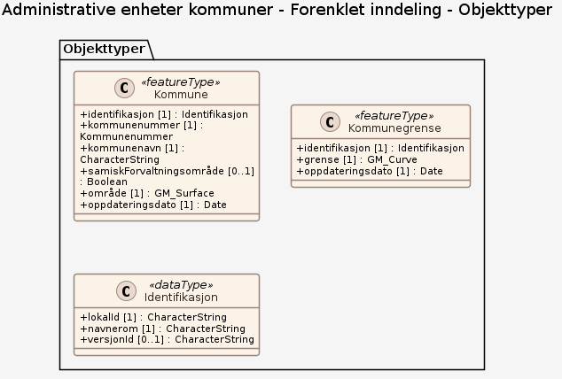
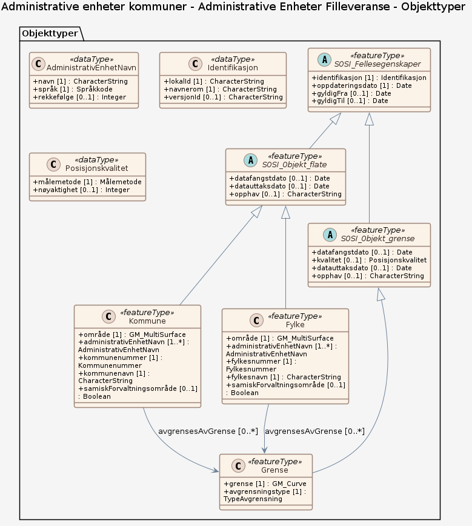

### Datamodell - Forenklet inndeling

➡️ [Se full datamodell for omfang "Forenklet inndeling" (diagram per pakke og objektkatalog)](forenklet-inndeling/objektkatalog.html)

### Datamodell - Administrative Enheter Filleveranse

➡️ [Se full datamodell for omfang "Administrative Enheter Filleveranse" (diagram per pakke og objektkatalog)](administrative-enheter-filleveranse/objektkatalog.html)
