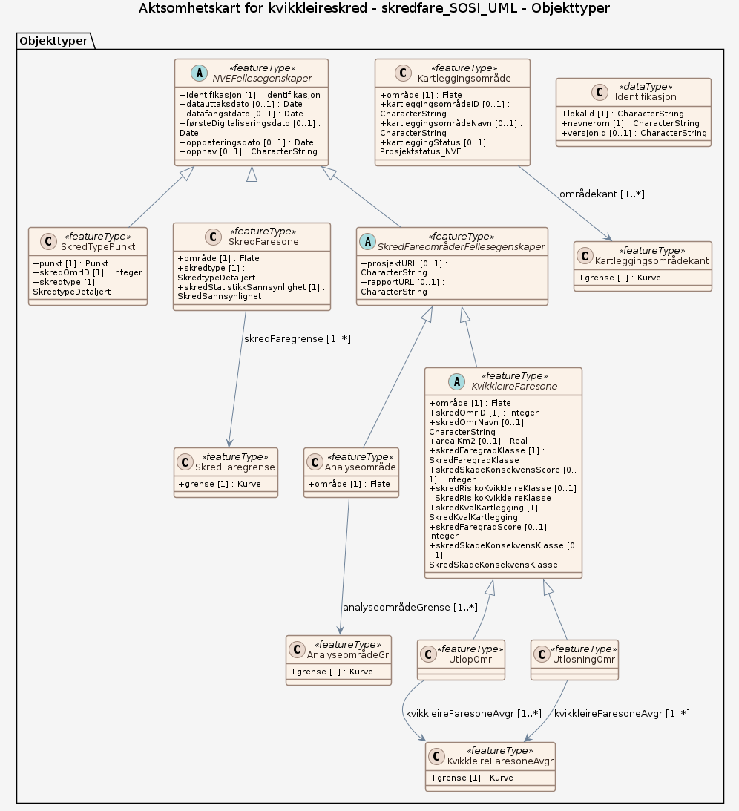

# Produktspesifikasjon: Aktsomhetskart for kvikkleireskred

*Aktsomhetskart for kvikkleireskred er utviklet av NVE, og tar hensyn til både løsmassene og terrenget. Det kan brukes for å følge steg 2 og 3 i «Prosedyre for utredning av områdeskredfare» i NVE veileder 1/2019 «Sikkerhet mot kvikkleireskred» kapittel 3.2.

Tidligere var det kartet «Aktsomhet marin leire» som ble benyttet for å sjekke steg 2 i prosedyren (Avgrens områder med mulig marin leire). «Aktsomhet marin leire» baserte seg på NGUs kart Mulighet for marin leire, og viste mulighet for sammenhengende forekomster av marin leire basert på løsmassekartene (kvartær-geologisk kartlegging). Det forelå ikke noe verktøy for steg 3 i prosedyren (Avgrens områder med terreng som kan være utsatt for områdeskred /kvikkleireskred).

Aktsomhetskartet bruker «Aktsomhet marin leire» som utgangspunkt og tar i tillegg hensyn til 
terreng-kriteriene som er gitt i NVE veileder 1/2019. Flate områder langt unna skråninger, er dermed fjernet fra aktsomhetskartet, i tillegg til områder uten sammenhengende marin leire. Områder kartlagt som «grunnlendt» og «fjell i dagen» i Nibio AR5 Grunnforhold er tatt vekk fra kartet.

Dersom planlagte tiltak ligger innenfor aktsomhetsområde for kvikkleireskred, må man gå videre i prosedyren i NVE veileder 1/2019. 
Metodikken aktsomhetskartet bygger på identifiserer mulige løsneområder for kvikkleireskred. NVE vurderte at aktsomhetskartet også markerer i tilstrekkelig grad hvor det kan være fare for skade fra utløp fra et kvikkleire-skred. Det er dermed ikke nødvendig å vurdere fare for utløp utenfor aktsomhetskartet. 
Unntaket er der det ligger utløp fra registrerte faresoner utenom aktsomhetsområdet, dette må i så fall følge prosedyren i NVE veileder 1/2019 videre fra steg 4.*

**Nøkkelord:** kvikkleire, skred, arealplan, Det offentlige kartgrunnlaget, geodataloven, Norge digitalt, Samfunnssikkerhet, Plan, AktsomhetsOmrKvikkleireskred, KvikkleireskredAktsomhetDekning, skredType, kartbladIndeks, dekningStatus

**Emnekategorier:** 

**Geografisk utstrekning**:

- **Vest**: 2.0
- **Øst**: 33.0
- **Sør**: 57.0
- **Nord**: 72.0

**Tidsmessig utstrekning**:

- **Tidsperiode**:
  - **Fra**: 2024-01-04
  - **Til**: 2026-10-10

## Om spesifikasjonen

> **Denne versjonen av produktspesifikasjonen:**  
> **Opprettet dato:** 2024-01-04 
> **Endret dato:** 2026-10-10 
> **Språk:** nor 
> **Kontaktinformasjon:** Norges vassdrags- og energidirektorat, [gisstotte@nve.no](mailto:gisstotte@nve.no)

## Termer og definisjoner
**Begrep** — kort forklaring

## Forkortelser

| Forkortelse | Betyr |
|-------------|-------|
| SOSI | Samordnet Opplegg for Stedfestet Informasjon |
| GML | Geography Markup Language |

## Om produktet Aktsomhetskart for kvikkleireskred

> **Romlig representasjonstype:** Vektor 
> **Unik identifikator:** <https://data.geonorge.no/sosi/samfunnssikkerhet/aktsomhetskart_kvikkleireskred> 
> **Kontaktinformasjon:** Norges vassdrags- og energidirektorat, [gisstotte@nve.no](mailto:gisstotte@nve.no)
>
> **Romlig oppløsning:**
>
> **Ekvivalent målestokk**: 50 000
>
> **Begrensninger:**
>
> **Juridiske begrensninger**:
>
> - **Tilgangsbegrensninger**: Åpne data
> - **Bruksbegrensninger**: Lisens
> - **Lisens**: Norsk lisens for offentlige data (NLOD)
> - **Lisenslenke**: <http://data.norge.no/nlod/no/1.0>

### Formål

Økt sikkerhet mot utløsning av kvikkleireskred, og tilfredsstillende sikkerhet i plan- og byggesaker.

### Bruksområde

Aktsomhetskartet kan brukes for å gjøre vurderingene i steg 2 til 3 i prosedyren i NVE 1/2019 kapittel 3, for å avdekke om tiltaket ligger i en mulig faresone for kvikkleireskred. Det vil si at dersom tiltaket ligger innenfor et aktsomhetsområde for kvikkleireskred, må tiltakshaveren fortsette med prosedyren fra steg 4. Dette vil i fleste tilfeller innebære å innhente geoteknisk kompetanse for å dokumentere tilstrekkelig sikkerhet mot kvikkleireskred, både for løsne- og utløpsområde.

## Omfang

### Hele datasettet

**Nivå**: dataset

**Nivåbeskrivelse**: Gjelder hele datasettet. Hvis omfang ikke er oppgitt under en overskrift, gjelder teksten for hele datasettet og alle leveranser

### skredfare_SOSI_UML

**Nivå**: dataset

**Nivåbeskrivelse**: Datamodell (SOSI UML (XMI))

## Datainnhold og struktur

### Datamodell - skredfare_SOSI_UML

➡️ [Se full datamodell for omfang "skredfare_SOSI_UML" (diagram per pakke og objektkatalog)](skredfare-sosi-uml/objektkatalog.html)

## Referansesystem

| EPSG-kode | Navn på referansesystem |
| --- | --- |
| [EPSG:25832](https://epsg.io/25832) | [EUREF89 UTM sone 32, 2d](https://register.geonorge.no/epsg-koder) |
| [EPSG:25833](https://epsg.io/25833) | [EUREF89 UTM sone 33, 2d](https://register.geonorge.no/epsg-koder) |
| [EPSG:25835](https://epsg.io/25835) | [EUREF89 UTM sone 35, 2d](https://register.geonorge.no/epsg-koder) |
| [EPSG:3035](https://epsg.io/3035) | [EUREF89 / ETRS89-LAEA Europe](https://register.geonorge.no/epsg-koder) |
| [EPSG:4258](https://epsg.io/4258) | [EUREF 89 Geografisk (ETRS 89) 2d](https://register.geonorge.no/epsg-koder) |

## Datakvalitet

**Nivå**: dataset

**Kvalitetsmål**: SOSI produktspesifikasjon: Aktsomhetskart for kvikkleireskred

- **Beskrivende resultat**: Dataene er i henhold til produktspesifikasjonen

**Kvalitetsmål**: Sosi applikasjonsskjema

- **Beskrivende resultat**: SOSI-filer er i henhold til applikasjonsskjema

**Kvalitetsmål**: Sosi applikasjonsskjema

- **Beskrivende resultat**: GML-filer er i henhold til applikasjonsskjema

**Kvalitetsmål**: Prosentvis dekning i forhold til datasettets utstrekning

- **Målebeskrivelse**: Datasettets faktiske kartlagte areal i forhold til datasettets spesifiserte utstrekning
- **Resultat**: 100

**Kvalitetsmål**: Prosentvis oppfyllelse av FAIR-prinsipper

- **Målebeskrivelse**: Angir fullstendighet i forhold til krav fra FAIR-prinsippene (The FAIR Guiding Principles for scientific data management and stewardship)
- **Resultat**: 100

## Datafangst og produksjon

I kartet er områder med terreng som kan være utsatt for kvikkleireskred er definert ved:  

Ravinert terreng med total skråningshøyde > 5 m  

Eller  

Jevnt hellende terreng brattere enn 1:15 og høydeforskjellen > 5m  

Aktsomhetskartet bruker 15 ganger høydeforskjell for å definere aktsomhetsområdene. Metodikken kartet følger er utarbeidet sammen med geoteknikere og det fanger opp alle aktuelle raviner og forsenkinger mv. hvor skred kan initieres, og tar hensyn til dybde under vann. Dette er på et detaljnivå som tilsvarer steg 5 i prosedyren i NVE veileder 1/2019, i stedet for kriteriene i steg 3 som benyttes uten geoteknisk kompetanse (20 ganger høydeforskjellen).  

Høydeforskjellen er beregnet fra modellerte kildepunkter langs skråningsfot. Kildepunktene ligger i det laveste punktet av en skråning der et skred kan initieres og forplante seg bakover. Riktig plasseringen av kildepunkt er funnet ved å beregne dreneringslinjer og vanndyp i elver og bekker. I større vassdrag, langs kystlinje og innsjøer hvor det er målt dybde, så er dyp på kildepunktene tatt direkte fra dette. Der det ikke fins innmålt dybde, er vanndypet beregnet ved hjelp av korrelasjonen fra Whitbread et al (2015) for vanndyp og nedbørsfeltareal. NVE jobber med å tilpasse denne korrelasjonen slik at det passer bedre for norske forhold. I tillegg ble kildepunkter satt opp langs kanten av store elver (-1,5 m dyp), innsjøer (-4,5 m dyp) og langs hele kystlinja (-1,0 m dyp der kysten er langgrunt, -7,5 m ellers), som gir konservative resultater i områder hvor det ikke fins innmålt dybde. Kartverkets Nasjonale detaljerte høydemodell (NDH) er brukt for beregningene.  

Terrengkriteriene er beregnet automatisk i områder med mulig sammenhengende marin leire, altså områder med middels, stor eller svært stor sannsynlighet for sammenhengende forekomster av marin leire i NGUs kart “Mulighet for marin leire”. Områder med usammenhengende/tynt dekke og liten mulighet for marin leire er tatt ut.

## Vedlikehold

**Vedlikeholdsfrekvens**: Etter behov

**Status**: Fullført

## Presentasjon

**navn**: Tegneregler

**Lenke**:
<https://register.geonorge.no/tegneregler/aktsomhetskart-for-kvikkleireskred>

## Leveranse

| Tjeneste | Endepunkt | Type | Format | Leveranseenheter |
| --- | --- | --- | --- | --- |
| Geonorge nedlastning | [Lenke](https://nedlasting.geonorge.no/api/capabilities/dabd2a2c-36d5-4ed7-a4c9-d49808a2b848) | GEONORGE:DOWNLOAD | FGDB, GML, PostGIS, SOSI | fylkesvis, kommunevis, landsfiler |
| Atom Feed | [Lenke](http://nedlasting.geonorge.no/geonorge/ATOM-feeds/KvikkleireAktsomhetskart_AtomFeedFGDB.xml) | W3C:AtomFeed | FGDB | fylkesvis, kommunevis, landsfiler |
| Atom Feed | [Lenke](http://nedlasting.geonorge.no/geonorge/ATOM-feeds/KvikkleireAktsomhetskart_AtomFeedGML.xml) | W3C:AtomFeed | GML | fylkesvis, kommunevis, landsfiler |
| Atom Feed | [Lenke](http://nedlasting.geonorge.no/geonorge/ATOM-feeds/KvikkleireAktsomhetskart_AtomFeedPostGIS.xml) | W3C:AtomFeed | PostGIS | fylkesvis, kommunevis, landsfiler |
| Atom Feed | [Lenke](http://nedlasting.geonorge.no/geonorge/ATOM-feeds/KvikkleireAktsomhetskart_AtomFeedSOSI.xml) | W3C:AtomFeed | SOSI | fylkesvis, kommunevis, landsfiler |
| Aktsomhetskart for kvikkleireskred WMS | [Lenke](https://kart.nve.no/enterprise/services/KvikkleireskredAktsomhet/MapServer/WMSServer?request=GetCapabilities&service=WMS) | WMS-tjeneste | PNG |  |
| GeoPackage: skredfare-sosi-uml | [Lenke](https://raw.githubusercontent.com/larsingea/ps_demo2/main/produktspesifikasjon/aktsomhetskart-for-kvikkleireskred/skredfare-sosi-uml/skredfare-sosi-uml.gpkg) | Nedlasting | GPKG |  |
| GML/XSD-skjema: skredfare-sosi-uml | [Lenke](https://raw.githubusercontent.com/larsingea/ps_demo2/main/produktspesifikasjon/aktsomhetskart-for-kvikkleireskred/skredfare-sosi-uml/schema/xsd/INPUT/skredfare-sosi-uml.xsd) | Nedlasting | XSD |  |

## Metadata

**Metadatastandard**: ISO19115

**Metadatastandardversjon**: 2003

**Metadatadato**: 2026-11-10

**språk**: nor

**Kontakt**:

- **Organisasjon**: Norges vassdrags- og energidirektorat
- **Kontaktperson**: Seksjon for geomatikk og dataanalyse
- **Logo**: <https://register.geonorge.no/data/organizations/970205039_NVE_liten.png>
- **Epost**: gisstotte@nve.no
- **rolle**: pointOfContact

**Metadataidentifikator**:

- **Utsteder**: Geonorge
- **kode**: dabd2a2c-36d5-4ed7-a4c9-d49808a2b848
- **koderom**: <https://kartkatalog.geonorge.no/metadata/>
- **Metadatalenke**: <https://kartkatalog.geonorge.no/metadata/dabd2a2c-36d5-4ed7-a4c9-d49808a2b848>

## Tilleggsinformasjon

- **Produktark:** [https://register.geonorge.no/produktark/aktsomhetskart-for-kvikkleireskred](https://register.geonorge.no/produktark/aktsomhetskart-for-kvikkleireskred)
- **Produktside:** [https://www.nve.no/naturfare/utredning-av-naturfare/om-kart-og-kartlegging-av-naturfare/om-kartlegging-av-fare-for-kvikkleireskred/aktsomhetskart-for-kvikkleireskred/](https://www.nve.no/naturfare/utredning-av-naturfare/om-kart-og-kartlegging-av-naturfare/om-kartlegging-av-fare-for-kvikkleireskred/aktsomhetskart-for-kvikkleireskred/)
