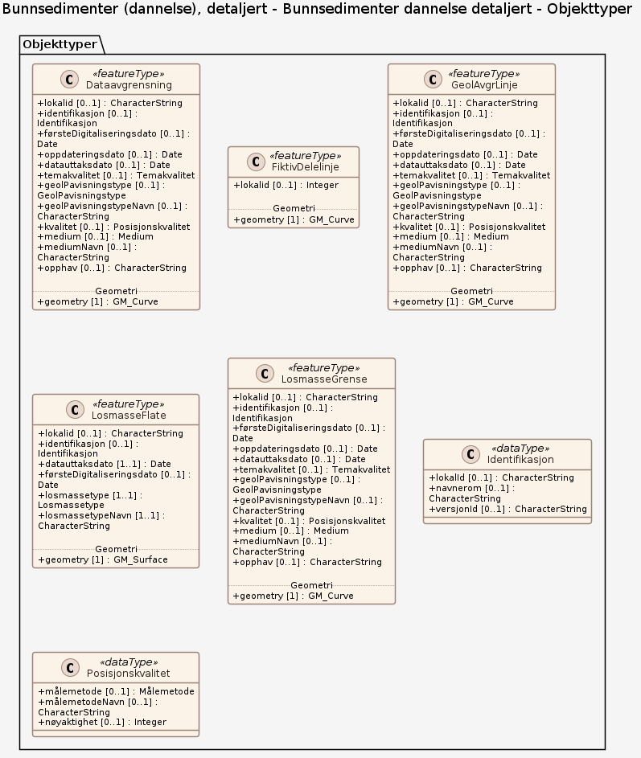

# Produktspesifikasjon: Bunnsedimenter (dannelse), detaljert

*Datasettet viser bunnsedimenter i havbunnens øvre del (1-2 m under sjøbunnen), klassifisert etter jordartstype. Dette kartet skal da tilsvare et kvartærgeologisk kart. Datasettet dekker kystnære områder der det er utført maringeologisk kartlegging i detaljert målestokk. Detaljeringsgrad varierer mellom data fra ulike kartleggingsprosjekter.*

**Nøkkelord:** avsetning, sediment, bart fjell, bunntyper, ekkolodd, geologi, habitat, hav, havbunn, løsmasser, MAREANO, marin, maringeologi, multistråleekkolodd, overflatesediment, undervanns, sjøbunn, kartlegging, natur, naturtype, NGU, prosesser, jordart, kvartære sedimenter, glasimarin, morene, skredavsetning, løsmasseskred, suspensjonsavsetning, bunnstrøm, Havområder, Inspire, Norge digitalt, geodataloven, MarineGrunnkart, fellesDatakatalog, ØkologiskGrunnkart

**Emnekategorier:** Geovitenskapelig informasjon

**Geografisk utstrekning**:

- **Vest**: 6.0
- **Øst**: 30.0
- **Sør**: 62.4
- **Nord**: 81.0

**Geografisk område**:
Norge, Rijpfjorden, Kongsfjorden, Ålesund og Giske, Stavanger

**Tidsmessig utstrekning**:

- **Tidsperiode**:
  - **Fra**: 2025-06-24
  - **Til**: 2025-06-24

## Om spesifikasjonen

> **Denne versjonen av produktspesifikasjonen:**  
> **Opprettet dato:**  
> **Endret dato:** 2025-06-24 
> **Språk:** nor 
> **Kontaktinformasjon:** Norges geologiske undersøkelse, [Reidulv.Boe@ngu.no](mailto:Reidulv.Boe@ngu.no)

## Om produktet Bunnsedimenter (dannelse), detaljert

> **Romlig representasjonstype:** Vektor 
> **Unik identifikator:** <https://data.geonorge.no/sosi/geologi/bunnsediment_dannelse_detalj> 
> **Kontaktinformasjon:** Norges geologiske undersøkelse, [Reidulv.Boe@ngu.no](mailto:Reidulv.Boe@ngu.no)
>
> **Romlig oppløsning:**
>
> **Ekvivalent målestokk**: 20000
>
> **Begrensninger:**
>
> **Ressursbegrensninger**:
>
> - **Bruksbegrensninger**: Detaljnivået på datasettet tilsier bruk innenfor kartmålestokken: 1:20.000 - 1:50.000
>
> **Juridiske begrensninger**:
>
> - **Tilgangsbegrensninger**: Åpne data
> - **Bruksbegrensninger**: Lisens
> - **Lisens**: Norsk lisens for offentlige data (NLOD)
> - **Lisenslenke**: <http://data.norge.no/nlod/no/1.0>
>
> **Sikkerhetsbegrensninger**:
>
> - **Klassifisering**: Ugradert

### Formål

Løsmasser er en naturressurs, som på lik linje med vann og luft er avgjørende for plante- og dyreliv. Kunnskap om løsmassene er nødvendig for forståelsen av prosesser i det marine miljø, og kunnskap om fordeling av løsmasser er viktig for en best mulig forvaltning av marine arealer og ressurser. \\nJordart som egenskap beskriver løsmassenes dannelsesmåte. Kart over løsmasser klassifisert etter jordartstype forklarer prosessene som har medvirket til områdets geologiske utvikling og særtrekk. Samtidig kan kunnskapen om geologiske prosesser og resulterende jordarter fortelle om løsmassenes beskaffenhet og egenskaper.

### Bruksområde

Datasettet kan anvendes som underlag i overordnet areal- og miljøplanlegging, sårbarhetsanalyser, habitatskartlegging, i forbindelse med installasjoner på sjøbunnen osv.

## Omfang

### Hele datasettet

**Nivå**: dataset

**Nivåbeskrivelse**: Gjelder hele datasettet. Hvis omfang ikke er oppgitt under en overskrift, gjelder teksten for hele datasettet og alle leveranser

### Bunnsedimenter dannelse detaljert

**Nivå**: dataset

**Nivåbeskrivelse**: OGC API – Features (koblet til datasettet i Geonorge)

## Datainnhold og struktur

### Datamodell - Bunnsedimenter dannelse detaljert

➡️ [Se full datamodell for omfang "Bunnsedimenter dannelse detaljert" (diagram per pakke og objektkatalog)](bunnsedimenter-dannelse-detaljert/objektkatalog.html)

## Referansesystem

| EPSG-kode | Navn på referansesystem |
| --- | --- |
| [EPSG:25832](https://epsg.io/25832) | [EUREF89 UTM sone 32, 2d](https://register.geonorge.no/epsg-koder) |
| [EPSG:25833](https://epsg.io/25833) | [EUREF89 UTM sone 33, 2d](https://register.geonorge.no/epsg-koder) |
| [EPSG:25835](https://epsg.io/25835) | [EUREF89 UTM sone 35, 2d](https://register.geonorge.no/epsg-koder) |
| [EPSG:32632](https://epsg.io/32632) | [WGS84 UTM sone 32, 2d](https://register.geonorge.no/epsg-koder) |
| [EPSG:32633](https://epsg.io/32633) | [WGS84 UTM sone 33, 2d](https://register.geonorge.no/epsg-koder) |
| [EPSG:32635](https://epsg.io/32635) | [WGS84 UTM sone 35, 2d](https://register.geonorge.no/epsg-koder) |
| [EPSG:4326](https://epsg.io/4326) | [WGS84 Geografisk](https://register.geonorge.no/epsg-koder) |

## Datakvalitet

**Nivå**: dataset

**Kvalitetsmål**: COMMISSION REGULATION (EU) No 1089/2010 of 23 November 2010 implementing Directive 2007/2/EC of the European Parliament and of the Council as regards interoperability of spatial data sets and services

- **Beskrivende resultat**: Datasettet er i henhold til nasjonal produktspesifikasjon

**Kvalitetsmål**: SOSI produktspesifikasjon: Bunnsedimenter dannelse

- **Beskrivende resultat**: Dataene er i henhold til produktspesifikasjonen

**Kvalitetsmål**: Sosi applikasjonsskjema

- **Beskrivende resultat**: SOSI-filer er i henhold til applikasjonsskjema

**Kvalitetsmål**: Sosi applikasjonsskjema

- **Beskrivende resultat**: GML-filer er i henhold til applikasjonsskjema

**Kvalitetsmål**: Prosentvis dekning i forhold til datasettets utstrekning

- **Målebeskrivelse**: Datasettets faktiske kartlagte areal i forhold til datasettets spesifiserte utstrekning
- **Resultat**: 5

**Kvalitetsmål**: Prosentvis oppfyllelse av FAIR-prinsipper

- **Målebeskrivelse**: Angir fullstendighet i forhold til krav fra FAIR-prinsippene (The FAIR Guiding Principles for scientific data management and stewardship)
- **Resultat**: 100

## Datafangst og produksjon

Datatemaet Bunnsedimenter (dannelse) er basert på kornstørrelsesdata, tolkning av video og prøver av sjøbunnen, tolkning av digitale reflektivitetsdata, tolkning av digitale seismiske data, samt eksisterende informasjon fra tidligere undesøkelser. Detaljerte vanndypsdata har inngått som støtte i tolkningen. Dataene er digitalisert og tilrettelagt vha. ArcGIS verktøy. Metodikken er beskrevet i egenskapsfeltene Målemetode og GeolPavisningstype. Temakoder og egenskaper følger i hovedsak SOSI-standarden. Datasettet er tolket og digitalisert av NGU, men grunnlaget for tolkninger er data fra Norges geologiske undersøkelse (NGU), Kartverket og Havforskningsinstituttet (HI).

## Vedlikehold

**Vedlikeholdsfrekvens**: Etter behov

**Status**: Fullført

## Presentasjon

**navn**: Tegneregler

**Lenke**:
<https://register.geonorge.no/tegneregler/bunnsedimenter-dannelse>

## Leveranse

| Tjeneste | Endepunkt | Type | Format | Leveranseenheter |
| --- | --- | --- | --- | --- |
| OGC API-Features | [Lenke](https://ogcapitest.ngu.no/rest/services/bunnsedimentdannelsedetalj) | OGC:API-Features | JSON |  |
| Egen nedlastningsside | [Lenke](https://geo.ngu.no/download/order?dataset=711) | WWW:DOWNLOAD-1.0-http--download | FGDB, SOSI, GML |  |
| Geonorge nedlastning | [Lenke](https://nedlasting.ngu.no/api/capabilities/8baa6e54-774e-4789-9e64-1c50f32098f4) | GEONORGE:DOWNLOAD | FGDB, GML, SOSI |  |
| Atom Feed | [Lenke](https://nedlasting.ngu.no/api/atom/8baa6e54-774e-4789-9e64-1c50f32098f4) | W3C:AtomFeed | FGDB, GML, SOSI |  |
| Marine bunnsedimenter WMS | [Lenke](https://geo.ngu.no/mapserver/MarinBunnsedimenterWMS/?request=getcapabilities&service=wms&version=1.3.0) | WMS-tjeneste | png |  |

## Metadata

**Metadatastandard**: ISO19115

**Metadatastandardversjon**: 2003

**Metadatadato**: 2026-11-12

**språk**: nor

**Kontakt**:

- **Organisasjon**: Norges geologiske undersøkelse
- **Kontaktperson**: Janne Grete Wesche
- **Logo**: <https://register.geonorge.no/data/organizations/970188290_NGU_hovedlogo_svart.svg> thumbnail.png
- **Epost**: metadataansvarlig@ngu.no
- **rolle**: pointOfContact

**Metadataidentifikator**:

- **Utsteder**: Geonorge
- **kode**: 8baa6e54-774e-4789-9e64-1c50f32098f4
- **koderom**: <https://kartkatalog.geonorge.no/metadata/>
- **Metadatalenke**: <https://kartkatalog.geonorge.no/metadata/8baa6e54-774e-4789-9e64-1c50f32098f4>

## Tilleggsinformasjon

Datasettet dekker kun enkelte områder i norske fjorder og kystnært hav, der ulike kartleggingsprosjekter har sørget for detaljert informasjon om havbunnen. Detaljeringsgrad varierer fra sted til sted. Kartene er digitalisert med tanke på presentasjon i målestokk 1:10 000 - 1:50 000 (detaljert kartlegging).

- **Produktark:** [https://register.geonorge.no/produktark/bunnsedimenter-dannelse-detaljert](https://register.geonorge.no/produktark/bunnsedimenter-dannelse-detaljert)
- **Produktside:** [http://www.ngu.no/emne/dannelse-av-bunnsedimenter](http://www.ngu.no/emne/dannelse-av-bunnsedimenter)
