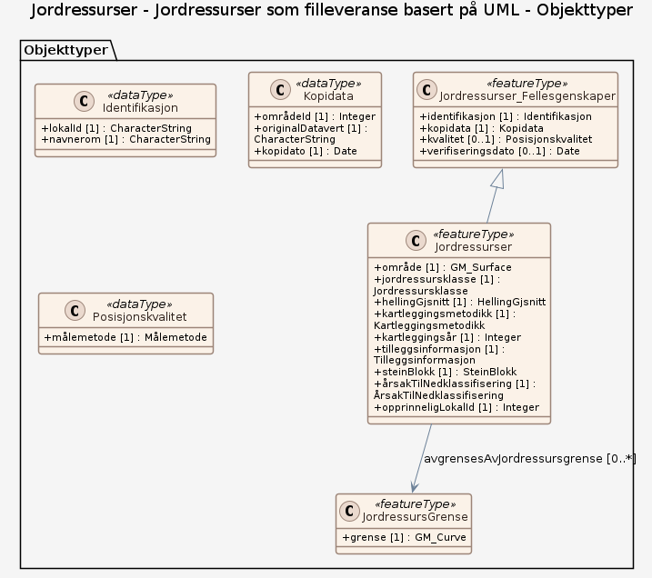

### Datamodell - Jordressurser som filleveranse basert på UML

➡️ [Se full datamodell for omfang "Jordressurser som filleveranse basert på UML" (diagram per pakke og objektkatalog)](jordressurser-som-filleveranse-basert-pa-uml/objektkatalog.html)
