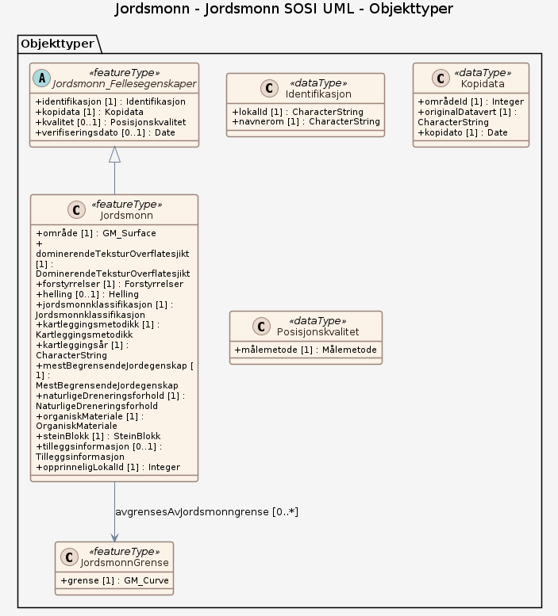

# Produktspesifikasjon: Jordsmonn

*NIBIO kartlegger jordsmonnet på fulldyrka og overflatedyrka jord basert på standardisert internasjonal metodikk og en fornorsket utgave av et internasjonalt klassifikasjonssystem. Arealer med like jordegenskaper avgrenses mot arealer med andre jordegenskaper. 

Datasettet inneholder en beskrivelse av seks temakart som har opphav i jorddata fra kartleggingen, samt informasjon om helling, stein og blokkinnhold, tilleggsinformasjon, kartleggingsmetodikk og kartleggingsår.*

**Nøkkelord:** Jordsmonn, Jordsmonnkartlegging, Jordegenskaper, Jordsmonnklassifikasjon, Miljøtiltak, Arealplanlegging, Jordbruk, Agronomi, Organisk materiale, Naturlige dreneringsforhold, Begrensende jordegenskap, Dominerende tekstur i overflatesjikt, Helling, Stein- og blokkinnhold, Kartleggingsmetodikk, Arealdekke, Landbruk, Landskap, Geologi

**Emnekategorier:** 

**Geografisk utstrekning**:

- **Vest**: 2.0
- **Øst**: 33.0
- **Sør**: 57.0
- **Nord**: 72.0

**Geografisk område**:
Fastlandsnorge, Jordkartlagt jordbruksareal, Fulldyrka jord, Overflatedyrka jord, 0ver 60 % av norges fulldyrka og overflatedyrka jord (2026)

**Tidsmessig utstrekning**:

- **Tidsperiode**:
  - **Fra**: 2026-09-17
  - **Til**: 2026-09-17

## Om spesifikasjonen

> **Denne versjonen av produktspesifikasjonen:**  
> **Opprettet dato:** 2026-09-17 
> **Endret dato:** 2026-09-17 
> **Språk:** nor 
> **Kontaktinformasjon:** Norsk institutt for bioøkonomi, [siri.svendgard-stokke@nibio.no](mailto:siri.svendgard-stokke@nibio.no)

## Om produktet Jordsmonn

> **Romlig representasjonstype:** Vektor 
> **Unik identifikator:** 0b960bb3-d9af-499e-a204-72833a4bcaaa 
> **Kontaktinformasjon:** Norsk institutt for bioøkonomi, [siri.svendgard-stokke@nibio.no](mailto:siri.svendgard-stokke@nibio.no)
>
> **Romlig oppløsning:**
>
> **Ekvivalent målestokk**: 1:5 000 til 1:40 000
>
> **Begrensninger:**
>
> **Ressursbegrensninger**:
>
> - **Bruksbegrensninger**: ingen
>
> **Juridiske begrensninger**:
>
> - **Tilgangsbegrensninger**: Åpne data
> - **Bruksbegrensninger**: Lisens
> - **Lisens**: Norsk lisens for offentlige data (NLOD) 2.0
> - **Lisenslenke**: <https://data.norge.no/nlod/no/2.0>
>
> **Sikkerhetsbegrensninger**:
>
> - **Klassifisering**: Ugradert

### Formål

Jordsmonndataene gir en god og detaljert oversikt over jordressursene i Norge. Jordsmonndata utgjør et objektivt kunnskapsgrunnlag for beslutninger om bruk av jordressursen.

### Bruksområde

Utstrekningsbeskrivelse
Datasettet finnes for kommuner der jordkartlegging er utført, samt for noen utvalgte arealer spredt over hele landet. Hvert år kartlegges nye kommuner, og dekningsgraden øker år for år.

## Omfang

### Hele datasettet

**Nivå**: dataset

**Nivåbeskrivelse**: Gjelder hele datasettet. Hvis omfang ikke er oppgitt under en overskrift, gjelder teksten for hele datasettet og alle leveranser

### Jordsmonn SOSI UML

**Nivå**: dataset

**Nivåbeskrivelse**: Datamodell fra SOSI UML

## Datainnhold og struktur

### Datamodell - Jordsmonn SOSI UML

➡️ [Se full datamodell for omfang "Jordsmonn SOSI UML" (diagram per pakke og objektkatalog)](jordsmonn-sosi-uml/objektkatalog.html)

## Referansesystem

| EPSG-kode | Navn på referansesystem |
| --- | --- |
| [EPSG:32632](https://epsg.io/32632) | [WGS84 UTM sone 32, 2d](https://register.geonorge.no/epsg-koder) |
| [EPSG:32633](https://epsg.io/32633) | [WGS84 UTM sone 33, 2d](https://register.geonorge.no/epsg-koder) |
| [EPSG:32635](https://epsg.io/32635) | [WGS84 UTM sone 35, 2d](https://register.geonorge.no/epsg-koder) |

## Datakvalitet

**Nivå**: dataset

**Kvalitetsmål**: SOSI produktspesifikasjon: Jordsmonn

- **Beskrivende resultat**: Dataene er ikke vurdert iht produktspesifikasjonen

## Datafangst og produksjon

Ulike jordtyper identifiseres i felt ved hjelp av jordbor. Opphavsmateriale, tekstur (kornstørrelse), innhold av organisk materiale, jordas naturlige dreneringsgrad, jorddybde og jordsmonnutvikling blir vurdert. Avgrensingen av jordtyper tegnes direkte inn på digitale flybilder i felt, og baseres på en kombinasjon av borstikk ned til en meters dybde, flybildetolking og GPS. I tillegg til jordtyper deles arealene inn på bakgrunn av terrengegenskaper som har vesentlig betydning for den praktiske bruken av arealene, slik som hellingsgrad og stein- og blokkinnhold.

## Vedlikehold

**Vedlikeholdsfrekvens**: Ikke planlagt

**Status**: Under arbeid

## Presentasjon

**navn**: Tegneregler

**Lenke**:
<https://register.geonorge.no/tegneregler/jordsmonn>

## Leveranse

| Tjeneste | Endepunkt | Type | Format | Leveranseenheter |
| --- | --- | --- | --- | --- |
| Geonorge nedlastning | [Lenke](https://kart8.nibio.no/api/capabilities/0b960bb3-d9af-499e-a204-72833a4bcaaa) | GEONORGE:DOWNLOAD | GML, GPKG | kommunevis, landsfiler |
| Harmonisert jordsmonn – WMS | [Lenke](https://wms.nibio.no/cgi-bin/jordsmonn_harmonisert?SERVICE=WMS&VERSION=1.3.0&REQUEST=GetCapabilities) | WMS-tjeneste | OGC WMS 1.3.0 |  |
| Jordsmonn - Potensial for grønnsaksdyrking - WMS | [Lenke](https://wms.nibio.no/cgi-bin/grsak?) | WMS-tjeneste | png |  |
| Erosjonsrisiko - WMS | [Lenke](https://wms.nibio.no/cgi-bin/jordsmonn_erosjonsrisiko?) | WMS-tjeneste | PNG |  |
| Jordressurser - WMS | [Lenke](https://wms.nibio.no/cgi-bin/jordressurser?service=wms&request=getcapabilities) | WMS-tjeneste | jpg |  |

## Metadata

**Metadatastandard**: ISO19115

**Metadatastandardversjon**: 2003

**Metadatadato**: 2026-09-18

**språk**: nor

**Kontakt**:

- **Organisasjon**: Norsk institutt for bioøkonomi
- **Kontaktperson**: Christina Sogge
- **Logo**: <https://register.geonorge.no/data/organizations/988983837_NIBIO_liten.jpg>
- **Epost**: gisdrift@nibio.no
- **rolle**: pointOfContact

**Metadataidentifikator**:

- **Utsteder**: Geonorge
- **kode**: 0b960bb3-d9af-499e-a204-72833a4bcaaa
- **koderom**: <https://kartkatalog.geonorge.no/metadata/>
- **Metadatalenke**: <https://kartkatalog.geonorge.no/metadata/0b960bb3-d9af-499e-a204-72833a4bcaaa>

## Tilleggsinformasjon

Jordsmonn kartlegges som hovedregel bare en gang. Løpende ajourføring av jordsmonndata utføres ikke. Kun noen få kommuner i Norge er ajourført siden kartleggingsprogrammet startet opp på begynnelsen av 1980-tallet.
 
Status
Fra oppstarten og fram til nå har kartleggings-metodikken endret seg, men det er i hovedsak de samme, stabile egenskapene ved jorda som fortsatt bestemmes ute i felt. I perioden 2018-2022 ble resultater fra de ulike kartleggingsmetodikkene samordnet/ harmonisert, og en oppdatering av databasen ble utført i henhold til dette arbeidet. 

Dagens harmoniserte jordsmonnbase ble lansert i mai 2022.

- **Produktark:** [https://register.geonorge.no/produktark/jordsmonn](https://register.geonorge.no/produktark/jordsmonn)
- **Produktside:** [https://nibio.no/tema/jord/jordkartlegging?locationfilter=true](https://nibio.no/tema/jord/jordkartlegging?locationfilter=true)
