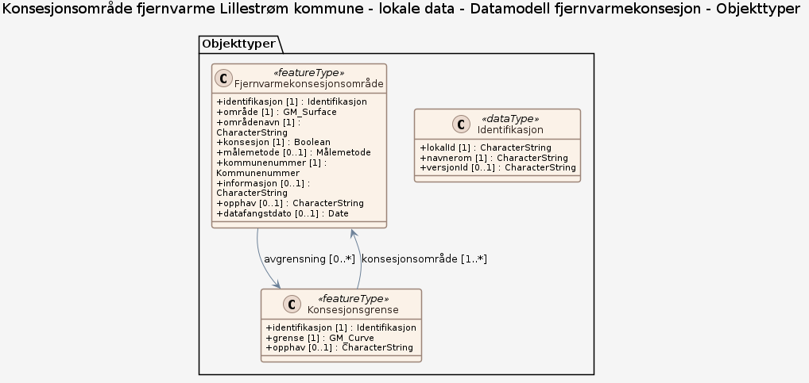

### Datamodell

**Kilde:** [JSON Schema](inputs/konsesjonsomrade-fjernvarme-lillestrom-kommune-lokale-data/datamodell-fjernvarmekonsesjon.feature_types.json)

#### Fjernvarmekonsesjonsområde

Område der det er gitt konsesjon for fjernvarme etter energiloven, i Lillestrøm kommune.

Egenskaper

<table class="feature-attribute-table">
  <thead>
    <tr>
      <th>Egenskap</th>
      <th>Beskrivelse</th>
      <th>Type</th>
      <th>Multiplisitet</th>
    </tr>
  </thead>
  <tbody>
    <tr>
      <td>identifikasjon</td>
      <td>Unik identifikasjon av et objekt, ivaretatt av den ansvarlige produsent/forvalter, som kan benyttes av eksterne applikasjoner som referanse til objektet.</td>
      <td>Identifikasjon (datatype)</td>
      <td>1</td>
    </tr>
    <tr>
      <td>- lokal<wbr />Id</td>
      <td>Lokal identifikator, tildelt av dataleverandør/dataforvalter. Den lokale identifikatoren er unik innenfor navnerommet.</td>
      <td>Character<wbr />String</td>
      <td>1</td>
    </tr>
    <tr>
      <td>- navnerom</td>
      <td>Navnerom som unikt identifiserer datakilden til objektet.</td>
      <td>Character<wbr />String</td>
      <td>1</td>
    </tr>
    <tr>
      <td>- versjon<wbr />Id</td>
      <td>Identifikasjon av en spesiell versjon av et geografisk objekt (instans).</td>
      <td>Character<wbr />String</td>
      <td>0..1</td>
    </tr>
    <tr>
      <td>område</td>
      <td>Konsesjonsområdets geografiske utstrekning som flate.</td>
      <td>GM_<wbr />Surface</td>
      <td>1</td>
    </tr>
    <tr>
      <td>områdenavn</td>
      <td>Navn på konsesjonsområdet, f.eks. tettstedet området dekker.</td>
      <td>Character<wbr />String</td>
      <td>1</td>
    </tr>
    <tr>
      <td>konsesjon</td>
      <td>Angir om det er gitt konsesjon for fjernvarme i området.</td>
      <td>Boolean</td>
      <td>1</td>
    </tr>
    <tr>
      <td>målemetode</td>
      <td>Metode som ligger til grunn for registrering av posisjon.</td>
      <td><a href="#kodeliste-målemetode">Målemetode</a> (kodeliste)</td>
      <td>0..1</td>
    </tr>
    <tr>
      <td>kommunenummer</td>
      <td>Firesifret kommunenummer der de to første sifrene angir fylkestilhørighet.</td>
      <td><a href="#kodeliste-kommunenummer">Kommunenummer</a> (kodeliste)</td>
      <td>1</td>
    </tr>
    <tr>
      <td>informasjon</td>
      <td>Utfyllende informasjon om objektet, f.eks. hvem som har utarbeidet dataene.</td>
      <td>Character<wbr />String</td>
      <td>0..1</td>
    </tr>
    <tr>
      <td>opphav</td>
      <td>Kilde eller tidspunkt for etablering av dataene.</td>
      <td>Character<wbr />String</td>
      <td>0..1</td>
    </tr>
    <tr>
      <td>datafangstdato</td>
      <td>Dato når objektet ble registrert/observert/målt første gang.</td>
      <td>Date</td>
      <td>0..1</td>
    </tr>
  </tbody>
</table>

Relasjoner

**Assosiasjoner**
Konsesjonsgrense – rolle: avgrensning – kardinalitet: 0..*

#### Konsesjonsgrense

Grenselinje som avgrenser et fjernvarmekonsesjonsområde.

Egenskaper

<table class="feature-attribute-table">
  <thead>
    <tr>
      <th>Egenskap</th>
      <th>Beskrivelse</th>
      <th>Type</th>
      <th>Multiplisitet</th>
    </tr>
  </thead>
  <tbody>
    <tr>
      <td>identifikasjon</td>
      <td>Unik identifikasjon av et objekt, ivaretatt av den ansvarlige produsent/forvalter, som kan benyttes av eksterne applikasjoner som referanse til objektet.</td>
      <td>Identifikasjon (datatype)</td>
      <td>1</td>
    </tr>
    <tr>
      <td>- lokal<wbr />Id</td>
      <td>Lokal identifikator, tildelt av dataleverandør/dataforvalter. Den lokale identifikatoren er unik innenfor navnerommet.</td>
      <td>Character<wbr />String</td>
      <td>1</td>
    </tr>
    <tr>
      <td>- navnerom</td>
      <td>Navnerom som unikt identifiserer datakilden til objektet.</td>
      <td>Character<wbr />String</td>
      <td>1</td>
    </tr>
    <tr>
      <td>- versjon<wbr />Id</td>
      <td>Identifikasjon av en spesiell versjon av et geografisk objekt (instans).</td>
      <td>Character<wbr />String</td>
      <td>0..1</td>
    </tr>
    <tr>
      <td>grense</td>
      <td>Grenselinjens forløp.</td>
      <td>GM_<wbr />Curve</td>
      <td>1</td>
    </tr>
    <tr>
      <td>opphav</td>
      <td>Kilde eller tidspunkt for etablering av dataene.</td>
      <td>Character<wbr />String</td>
      <td>0..1</td>
    </tr>
  </tbody>
</table>

Relasjoner

**Assosiasjoner**
Fjernvarmekonsesjonsområde – rolle: konsesjonsområde – kardinalitet: 1..*

### Kodelister

#### «CodeList» Målemetode

Profilparametre i tagged values

<table class="feature-attribute-table">
  <colgroup>
    <col style="width: 35%;" />
    <col style="width: 65%;" />
  </colgroup>
  <tbody>
    <tr>
      <th scope="row">asDictionary</th>
      <td>true</td>
    </tr>
    <tr>
      <th scope="row">codeList</th>
      <td><a href="https://register.geonorge.no/sosi-kodelister/generelle-konsepter/5.1/målemetode">https://register.geonorge.no/sosi-kodelister/generelle-konsepter/5.1/målemetode</a></td>
    </tr>
  </tbody>
</table>

#### «CodeList» Kommunenummer

Profilparametre i tagged values

<table class="feature-attribute-table">
  <colgroup>
    <col style="width: 35%;" />
    <col style="width: 65%;" />
  </colgroup>
  <tbody>
    <tr>
      <th scope="row">asDictionary</th>
      <td>true</td>
    </tr>
    <tr>
      <th scope="row">codeList</th>
      <td><a href="https://register.geonorge.no/sosi-kodelister/inndelinger/inndelingsbase/kommunenummer">https://register.geonorge.no/sosi-kodelister/inndelinger/inndelingsbase/kommunenummer</a></td>
    </tr>
  </tbody>
</table>
