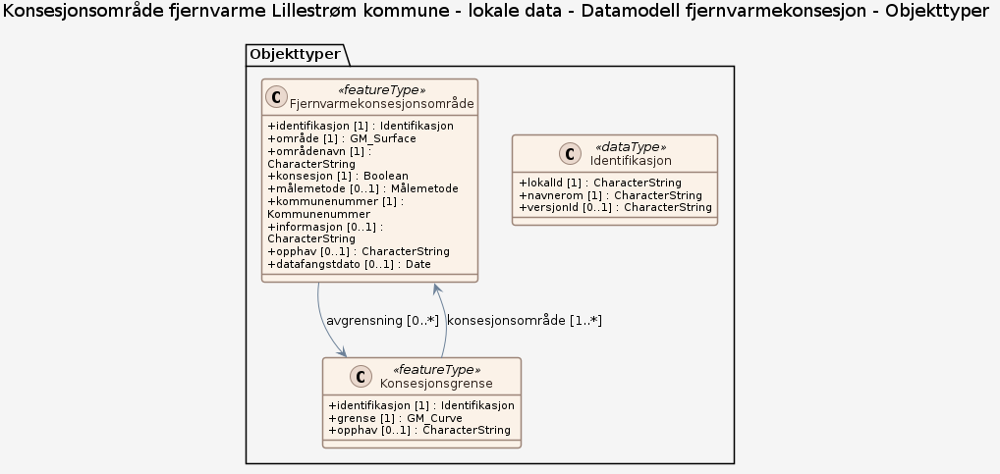

# Produktspesifikasjon: Konsesjonsområde fjernvarme Lillestrøm kommune - lokale data

*Datasettet viser hvilke områder som omfattes av konsesjon for fjernvarme i Lillestrøm kommune.
Foreligger for nedlasting som Shape, Esri filgeodatabase og SOSI i UTM sone 32.*

**Nøkkelord:** Fjernvarme, Konsesjonsområde, Det offentlige kartgrunnlaget, fellesDatakatalog, Energi

**Emnekategorier:** Plan og eiendom

**Geografisk utstrekning**:

- **Vest**: 10.933734
- **Øst**: 11.439506
- **Sør**: 59.75385
- **Nord**: 60.077247

**Geografisk område**:
Lillestrøm kommune, Lillestrøm, Sørumsand, Skedsmokorset

**Tidsmessig utstrekning**:

- **Tidsperiode**:
  - **Fra**: 2016-12-23
  - **Til**: 2021-10-01

## Om spesifikasjonen

> **Denne versjonen av produktspesifikasjonen:**  
> **Opprettet dato:** 2016-12-23 
> **Endret dato:** 2021-10-01 
> **Språk:** nor 
> **Kontaktinformasjon:** Lillestrøm kommune, [geodata@lillestrom.kommune.no](mailto:geodata@lillestrom.kommune.no)

## Om produktet Konsesjonsområde fjernvarme Lillestrøm kommune - lokale data

> **Romlig representasjonstype:** Vektor 
> **Unik identifikator:** 95867501-5b48-402d-8cb9-1d8a9b1c7bfc 
> **Kontaktinformasjon:** Lillestrøm kommune, [geodata@lillestrom.kommune.no](mailto:geodata@lillestrom.kommune.no)
>
> **Romlig oppløsning:**
>
>
>
> **Begrensninger:**
>
> **Juridiske begrensninger**:
>
> - **Tilgangsbegrensninger**: Åpne data
> - **Bruksbegrensninger**: Lisens
> - **Lisens**: Norsk lisens for offentlige data (NLOD)
> - **Lisenslenke**: <http://data.norge.no/nlod/no/1.0>
> - **Andre begrensninger**: otherRestrictions

### Formål

Plan- og byggesaksbehandling

### Bruksområde

Plan- og byggesaksbehandling

## Omfang

### Hele datasettet

**Nivå**: dataset

**Nivåbeskrivelse**: Gjelder hele datasettet. Hvis omfang ikke er oppgitt under en overskrift, gjelder teksten for hele datasettet og alle leveranser

### Datamodell fjernvarmekonsesjon

**Nivå**: dataset

**Nivåbeskrivelse**: Datamodell (Manuell datamodell)

## Datainnhold og struktur

### Datamodell - Datamodell fjernvarmekonsesjon

➡️ [Se full datamodell for omfang "Datamodell fjernvarmekonsesjon" (diagram per pakke og objektkatalog)](datamodell-fjernvarmekonsesjon/objektkatalog.html)

## Datakvalitet

**Nivå**: dataset

## Vedlikehold

**Vedlikeholdsfrekvens**: Etter behov

## Leveranse

| Tjeneste | Endepunkt | Type | Format | Leveranseenheter |
| --- | --- | --- | --- | --- |
| Egen nedlastningsside | [Lenke](https://nedlasting.geonorge.no/geonorge/kommunaleDokData/95867501-5b48-402d-8cb9-1d8a9b1c7bfc.zip) | WWW:DOWNLOAD-1.0-http--download | FGDB, SOSI, Shape | kommunevis |
| GeoPackage: datamodell-fjernvarmekonsesjon | [Lenke](https://raw.githubusercontent.com/larsingea/ps_demo2/main/produktspesifikasjon/konsesjonsomrade-fjernvarme-lillestrom-kommune-lokale-data/datamodell-fjernvarmekonsesjon/datamodell-fjernvarmekonsesjon.gpkg) | Nedlasting | GPKG |  |

## Metadata

**Metadatastandard**: ISO19115

**Metadatastandardversjon**: 2003

**Metadatadato**: 2024-01-03

**språk**: nor

**Kontakt**:

- **Organisasjon**: Lillestrøm kommune
- **Logo**: <https://register.geonorge.no/data/organizations/820710592_lillestrom_liten.jpg>
- **Epost**: geodata@lillestrom.kommune.no
- **rolle**: pointOfContact

**Metadataidentifikator**:

- **Utsteder**: Geonorge
- **kode**: 95867501-5b48-402d-8cb9-1d8a9b1c7bfc
- **koderom**: <https://kartkatalog.geonorge.no/metadata/>
- **Metadatalenke**: <https://kartkatalog.geonorge.no/metadata/95867501-5b48-402d-8cb9-1d8a9b1c7bfc>

