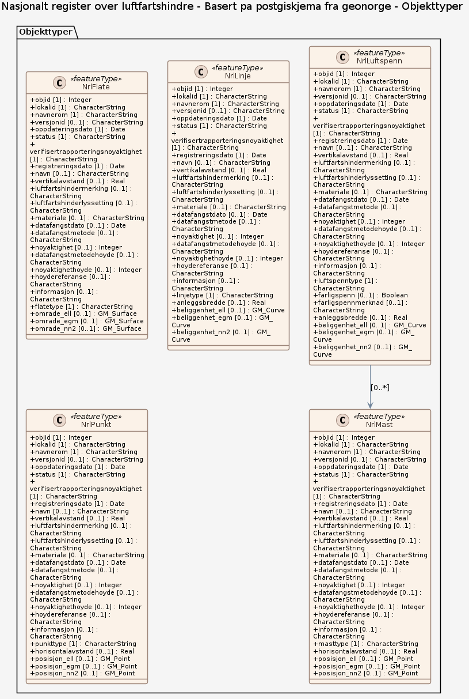

### Datamodell

**Kilde:** [PostGIS-skjema (SQL)](inputs/nasjonalt-register-over-luftfartshindre/postgis.schema.sql)

#### NrlFlate

Egenskaper

<table class="feature-attribute-table">
  <thead>
    <tr>
      <th>Egenskap</th>
      <th>Beskrivelse</th>
      <th>Type</th>
      <th>Multiplisitet</th>
    </tr>
  </thead>
  <tbody>
    <tr>
      <td>objid</td>
      <td></td>
      <td>integer</td>
      <td>1</td>
    </tr>
    <tr>
      <td>lokalid</td>
      <td></td>
      <td>string</td>
      <td>1</td>
    </tr>
    <tr>
      <td>navnerom</td>
      <td></td>
      <td>string</td>
      <td>1</td>
    </tr>
    <tr>
      <td>versjonid</td>
      <td></td>
      <td>string</td>
      <td>0..1</td>
    </tr>
    <tr>
      <td>oppdateringsdato</td>
      <td></td>
      <td>date<wbr />Time</td>
      <td>1</td>
    </tr>
    <tr>
      <td>status</td>
      <td></td>
      <td><a href="#kodeliste-string">string</a> (kodeliste)</td>
      <td>1</td>
    </tr>
    <tr>
      <td>verifisertrapporteringsnoyaktighet</td>
      <td></td>
      <td><a href="#kodeliste-string">string</a> (kodeliste)</td>
      <td>1</td>
    </tr>
    <tr>
      <td>registreringsdato</td>
      <td></td>
      <td>date<wbr />Time</td>
      <td>1</td>
    </tr>
    <tr>
      <td>navn</td>
      <td></td>
      <td>string</td>
      <td>0..1</td>
    </tr>
    <tr>
      <td>vertikalavstand</td>
      <td></td>
      <td>number</td>
      <td>0..1</td>
    </tr>
    <tr>
      <td>luftfartshindermerking</td>
      <td></td>
      <td><a href="#kodeliste-string">string</a> (kodeliste)</td>
      <td>0..1</td>
    </tr>
    <tr>
      <td>luftfartshinderlyssetting</td>
      <td></td>
      <td><a href="#kodeliste-string">string</a> (kodeliste)</td>
      <td>0..1</td>
    </tr>
    <tr>
      <td>materiale</td>
      <td></td>
      <td><a href="#kodeliste-string">string</a> (kodeliste)</td>
      <td>0..1</td>
    </tr>
    <tr>
      <td>datafangstdato</td>
      <td></td>
      <td>date</td>
      <td>0..1</td>
    </tr>
    <tr>
      <td>datafangstmetode</td>
      <td></td>
      <td><a href="#kodeliste-string">string</a> (kodeliste)</td>
      <td>0..1</td>
    </tr>
    <tr>
      <td>noyaktighet</td>
      <td></td>
      <td>integer</td>
      <td>0..1</td>
    </tr>
    <tr>
      <td>datafangstmetodehoyde</td>
      <td></td>
      <td><a href="#kodeliste-string">string</a> (kodeliste)</td>
      <td>0..1</td>
    </tr>
    <tr>
      <td>noyaktighethoyde</td>
      <td></td>
      <td>integer</td>
      <td>0..1</td>
    </tr>
    <tr>
      <td>hoydereferanse</td>
      <td></td>
      <td><a href="#kodeliste-string">string</a> (kodeliste)</td>
      <td>0..1</td>
    </tr>
    <tr>
      <td>informasjon</td>
      <td></td>
      <td>string</td>
      <td>0..1</td>
    </tr>
    <tr>
      <td>flatetype</td>
      <td></td>
      <td><a href="#kodeliste-string">string</a> (kodeliste)</td>
      <td>1</td>
    </tr>
    <tr>
      <td>omrade_<wbr />ell</td>
      <td></td>
      <td>GM_<wbr />Surface</td>
      <td>0..1</td>
    </tr>
    <tr>
      <td>omrade_<wbr />egm</td>
      <td></td>
      <td>GM_<wbr />Surface</td>
      <td>0..1</td>
    </tr>
    <tr>
      <td>omrade_<wbr />nn2</td>
      <td></td>
      <td>GM_<wbr />Surface</td>
      <td>0..1</td>
    </tr>
  </tbody>
</table>

#### NrlLinje

Egenskaper

<table class="feature-attribute-table">
  <thead>
    <tr>
      <th>Egenskap</th>
      <th>Beskrivelse</th>
      <th>Type</th>
      <th>Multiplisitet</th>
    </tr>
  </thead>
  <tbody>
    <tr>
      <td>objid</td>
      <td></td>
      <td>integer</td>
      <td>1</td>
    </tr>
    <tr>
      <td>lokalid</td>
      <td></td>
      <td>string</td>
      <td>1</td>
    </tr>
    <tr>
      <td>navnerom</td>
      <td></td>
      <td>string</td>
      <td>1</td>
    </tr>
    <tr>
      <td>versjonid</td>
      <td></td>
      <td>string</td>
      <td>0..1</td>
    </tr>
    <tr>
      <td>oppdateringsdato</td>
      <td></td>
      <td>date<wbr />Time</td>
      <td>1</td>
    </tr>
    <tr>
      <td>status</td>
      <td></td>
      <td><a href="#kodeliste-string">string</a> (kodeliste)</td>
      <td>1</td>
    </tr>
    <tr>
      <td>verifisertrapporteringsnoyaktighet</td>
      <td></td>
      <td><a href="#kodeliste-string">string</a> (kodeliste)</td>
      <td>1</td>
    </tr>
    <tr>
      <td>registreringsdato</td>
      <td></td>
      <td>date<wbr />Time</td>
      <td>1</td>
    </tr>
    <tr>
      <td>navn</td>
      <td></td>
      <td>string</td>
      <td>0..1</td>
    </tr>
    <tr>
      <td>vertikalavstand</td>
      <td></td>
      <td>number</td>
      <td>0..1</td>
    </tr>
    <tr>
      <td>luftfartshindermerking</td>
      <td></td>
      <td><a href="#kodeliste-string">string</a> (kodeliste)</td>
      <td>0..1</td>
    </tr>
    <tr>
      <td>luftfartshinderlyssetting</td>
      <td></td>
      <td><a href="#kodeliste-string">string</a> (kodeliste)</td>
      <td>0..1</td>
    </tr>
    <tr>
      <td>materiale</td>
      <td></td>
      <td><a href="#kodeliste-string">string</a> (kodeliste)</td>
      <td>0..1</td>
    </tr>
    <tr>
      <td>datafangstdato</td>
      <td></td>
      <td>date</td>
      <td>0..1</td>
    </tr>
    <tr>
      <td>datafangstmetode</td>
      <td></td>
      <td><a href="#kodeliste-string">string</a> (kodeliste)</td>
      <td>0..1</td>
    </tr>
    <tr>
      <td>noyaktighet</td>
      <td></td>
      <td>integer</td>
      <td>0..1</td>
    </tr>
    <tr>
      <td>datafangstmetodehoyde</td>
      <td></td>
      <td><a href="#kodeliste-string">string</a> (kodeliste)</td>
      <td>0..1</td>
    </tr>
    <tr>
      <td>noyaktighethoyde</td>
      <td></td>
      <td>integer</td>
      <td>0..1</td>
    </tr>
    <tr>
      <td>hoydereferanse</td>
      <td></td>
      <td><a href="#kodeliste-string">string</a> (kodeliste)</td>
      <td>0..1</td>
    </tr>
    <tr>
      <td>informasjon</td>
      <td></td>
      <td>string</td>
      <td>0..1</td>
    </tr>
    <tr>
      <td>linjetype</td>
      <td></td>
      <td><a href="#kodeliste-string">string</a> (kodeliste)</td>
      <td>1</td>
    </tr>
    <tr>
      <td>anleggsbredde</td>
      <td></td>
      <td>number</td>
      <td>0..1</td>
    </tr>
    <tr>
      <td>beliggenhet_<wbr />ell</td>
      <td></td>
      <td>GM_<wbr />Curve</td>
      <td>0..1</td>
    </tr>
    <tr>
      <td>beliggenhet_<wbr />egm</td>
      <td></td>
      <td>GM_<wbr />Curve</td>
      <td>0..1</td>
    </tr>
    <tr>
      <td>beliggenhet_<wbr />nn2</td>
      <td></td>
      <td>GM_<wbr />Curve</td>
      <td>0..1</td>
    </tr>
  </tbody>
</table>

#### NrlLuftspenn

Egenskaper

<table class="feature-attribute-table">
  <thead>
    <tr>
      <th>Egenskap</th>
      <th>Beskrivelse</th>
      <th>Type</th>
      <th>Multiplisitet</th>
    </tr>
  </thead>
  <tbody>
    <tr>
      <td>objid</td>
      <td></td>
      <td>integer</td>
      <td>1</td>
    </tr>
    <tr>
      <td>lokalid</td>
      <td></td>
      <td>string</td>
      <td>1</td>
    </tr>
    <tr>
      <td>navnerom</td>
      <td></td>
      <td>string</td>
      <td>1</td>
    </tr>
    <tr>
      <td>versjonid</td>
      <td></td>
      <td>string</td>
      <td>0..1</td>
    </tr>
    <tr>
      <td>oppdateringsdato</td>
      <td></td>
      <td>date<wbr />Time</td>
      <td>1</td>
    </tr>
    <tr>
      <td>status</td>
      <td></td>
      <td><a href="#kodeliste-string">string</a> (kodeliste)</td>
      <td>1</td>
    </tr>
    <tr>
      <td>verifisertrapporteringsnoyaktighet</td>
      <td></td>
      <td><a href="#kodeliste-string">string</a> (kodeliste)</td>
      <td>1</td>
    </tr>
    <tr>
      <td>registreringsdato</td>
      <td></td>
      <td>date<wbr />Time</td>
      <td>1</td>
    </tr>
    <tr>
      <td>navn</td>
      <td></td>
      <td>string</td>
      <td>0..1</td>
    </tr>
    <tr>
      <td>vertikalavstand</td>
      <td></td>
      <td>number</td>
      <td>0..1</td>
    </tr>
    <tr>
      <td>luftfartshindermerking</td>
      <td></td>
      <td><a href="#kodeliste-string">string</a> (kodeliste)</td>
      <td>0..1</td>
    </tr>
    <tr>
      <td>luftfartshinderlyssetting</td>
      <td></td>
      <td><a href="#kodeliste-string">string</a> (kodeliste)</td>
      <td>0..1</td>
    </tr>
    <tr>
      <td>materiale</td>
      <td></td>
      <td><a href="#kodeliste-string">string</a> (kodeliste)</td>
      <td>0..1</td>
    </tr>
    <tr>
      <td>datafangstdato</td>
      <td></td>
      <td>date</td>
      <td>0..1</td>
    </tr>
    <tr>
      <td>datafangstmetode</td>
      <td></td>
      <td><a href="#kodeliste-string">string</a> (kodeliste)</td>
      <td>0..1</td>
    </tr>
    <tr>
      <td>noyaktighet</td>
      <td></td>
      <td>integer</td>
      <td>0..1</td>
    </tr>
    <tr>
      <td>datafangstmetodehoyde</td>
      <td></td>
      <td><a href="#kodeliste-string">string</a> (kodeliste)</td>
      <td>0..1</td>
    </tr>
    <tr>
      <td>noyaktighethoyde</td>
      <td></td>
      <td>integer</td>
      <td>0..1</td>
    </tr>
    <tr>
      <td>hoydereferanse</td>
      <td></td>
      <td><a href="#kodeliste-string">string</a> (kodeliste)</td>
      <td>0..1</td>
    </tr>
    <tr>
      <td>informasjon</td>
      <td></td>
      <td>string</td>
      <td>0..1</td>
    </tr>
    <tr>
      <td>luftspenntype</td>
      <td></td>
      <td><a href="#kodeliste-string">string</a> (kodeliste)</td>
      <td>1</td>
    </tr>
    <tr>
      <td>farligspenn</td>
      <td></td>
      <td>boolean</td>
      <td>0..1</td>
    </tr>
    <tr>
      <td>farligspennmerknad</td>
      <td></td>
      <td>string</td>
      <td>0..1</td>
    </tr>
    <tr>
      <td>anleggsbredde</td>
      <td></td>
      <td>number</td>
      <td>0..1</td>
    </tr>
    <tr>
      <td>beliggenhet_<wbr />ell</td>
      <td></td>
      <td>GM_<wbr />Curve</td>
      <td>0..1</td>
    </tr>
    <tr>
      <td>beliggenhet_<wbr />egm</td>
      <td></td>
      <td>GM_<wbr />Curve</td>
      <td>0..1</td>
    </tr>
    <tr>
      <td>beliggenhet_<wbr />nn2</td>
      <td></td>
      <td>GM_<wbr />Curve</td>
      <td>0..1</td>
    </tr>
  </tbody>
</table>

Relasjoner

**Assosiasjoner**
NrlMast – kardinalitet: 0..*

#### NrlMast

Egenskaper

<table class="feature-attribute-table">
  <thead>
    <tr>
      <th>Egenskap</th>
      <th>Beskrivelse</th>
      <th>Type</th>
      <th>Multiplisitet</th>
    </tr>
  </thead>
  <tbody>
    <tr>
      <td>objid</td>
      <td></td>
      <td>integer</td>
      <td>1</td>
    </tr>
    <tr>
      <td>lokalid</td>
      <td></td>
      <td>string</td>
      <td>1</td>
    </tr>
    <tr>
      <td>navnerom</td>
      <td></td>
      <td>string</td>
      <td>1</td>
    </tr>
    <tr>
      <td>versjonid</td>
      <td></td>
      <td>string</td>
      <td>0..1</td>
    </tr>
    <tr>
      <td>oppdateringsdato</td>
      <td></td>
      <td>date<wbr />Time</td>
      <td>1</td>
    </tr>
    <tr>
      <td>status</td>
      <td></td>
      <td><a href="#kodeliste-string">string</a> (kodeliste)</td>
      <td>1</td>
    </tr>
    <tr>
      <td>verifisertrapporteringsnoyaktighet</td>
      <td></td>
      <td><a href="#kodeliste-string">string</a> (kodeliste)</td>
      <td>1</td>
    </tr>
    <tr>
      <td>registreringsdato</td>
      <td></td>
      <td>date<wbr />Time</td>
      <td>1</td>
    </tr>
    <tr>
      <td>navn</td>
      <td></td>
      <td>string</td>
      <td>0..1</td>
    </tr>
    <tr>
      <td>vertikalavstand</td>
      <td></td>
      <td>number</td>
      <td>0..1</td>
    </tr>
    <tr>
      <td>luftfartshindermerking</td>
      <td></td>
      <td><a href="#kodeliste-string">string</a> (kodeliste)</td>
      <td>0..1</td>
    </tr>
    <tr>
      <td>luftfartshinderlyssetting</td>
      <td></td>
      <td><a href="#kodeliste-string">string</a> (kodeliste)</td>
      <td>0..1</td>
    </tr>
    <tr>
      <td>materiale</td>
      <td></td>
      <td><a href="#kodeliste-string">string</a> (kodeliste)</td>
      <td>0..1</td>
    </tr>
    <tr>
      <td>datafangstdato</td>
      <td></td>
      <td>date</td>
      <td>0..1</td>
    </tr>
    <tr>
      <td>datafangstmetode</td>
      <td></td>
      <td><a href="#kodeliste-string">string</a> (kodeliste)</td>
      <td>0..1</td>
    </tr>
    <tr>
      <td>noyaktighet</td>
      <td></td>
      <td>integer</td>
      <td>0..1</td>
    </tr>
    <tr>
      <td>datafangstmetodehoyde</td>
      <td></td>
      <td><a href="#kodeliste-string">string</a> (kodeliste)</td>
      <td>0..1</td>
    </tr>
    <tr>
      <td>noyaktighethoyde</td>
      <td></td>
      <td>integer</td>
      <td>0..1</td>
    </tr>
    <tr>
      <td>hoydereferanse</td>
      <td></td>
      <td><a href="#kodeliste-string">string</a> (kodeliste)</td>
      <td>0..1</td>
    </tr>
    <tr>
      <td>informasjon</td>
      <td></td>
      <td>string</td>
      <td>0..1</td>
    </tr>
    <tr>
      <td>masttype</td>
      <td></td>
      <td><a href="#kodeliste-string">string</a> (kodeliste)</td>
      <td>1</td>
    </tr>
    <tr>
      <td>horisontalavstand</td>
      <td></td>
      <td>number</td>
      <td>0..1</td>
    </tr>
    <tr>
      <td>posisjon_<wbr />ell</td>
      <td></td>
      <td>GM_<wbr />Point</td>
      <td>0..1</td>
    </tr>
    <tr>
      <td>posisjon_<wbr />egm</td>
      <td></td>
      <td>GM_<wbr />Point</td>
      <td>0..1</td>
    </tr>
    <tr>
      <td>posisjon_<wbr />nn2</td>
      <td></td>
      <td>GM_<wbr />Point</td>
      <td>0..1</td>
    </tr>
  </tbody>
</table>

#### NrlPunkt

Egenskaper

<table class="feature-attribute-table">
  <thead>
    <tr>
      <th>Egenskap</th>
      <th>Beskrivelse</th>
      <th>Type</th>
      <th>Multiplisitet</th>
    </tr>
  </thead>
  <tbody>
    <tr>
      <td>objid</td>
      <td></td>
      <td>integer</td>
      <td>1</td>
    </tr>
    <tr>
      <td>lokalid</td>
      <td></td>
      <td>string</td>
      <td>1</td>
    </tr>
    <tr>
      <td>navnerom</td>
      <td></td>
      <td>string</td>
      <td>1</td>
    </tr>
    <tr>
      <td>versjonid</td>
      <td></td>
      <td>string</td>
      <td>0..1</td>
    </tr>
    <tr>
      <td>oppdateringsdato</td>
      <td></td>
      <td>date<wbr />Time</td>
      <td>1</td>
    </tr>
    <tr>
      <td>status</td>
      <td></td>
      <td><a href="#kodeliste-string">string</a> (kodeliste)</td>
      <td>1</td>
    </tr>
    <tr>
      <td>verifisertrapporteringsnoyaktighet</td>
      <td></td>
      <td><a href="#kodeliste-string">string</a> (kodeliste)</td>
      <td>1</td>
    </tr>
    <tr>
      <td>registreringsdato</td>
      <td></td>
      <td>date<wbr />Time</td>
      <td>1</td>
    </tr>
    <tr>
      <td>navn</td>
      <td></td>
      <td>string</td>
      <td>0..1</td>
    </tr>
    <tr>
      <td>vertikalavstand</td>
      <td></td>
      <td>number</td>
      <td>0..1</td>
    </tr>
    <tr>
      <td>luftfartshindermerking</td>
      <td></td>
      <td><a href="#kodeliste-string">string</a> (kodeliste)</td>
      <td>0..1</td>
    </tr>
    <tr>
      <td>luftfartshinderlyssetting</td>
      <td></td>
      <td><a href="#kodeliste-string">string</a> (kodeliste)</td>
      <td>0..1</td>
    </tr>
    <tr>
      <td>materiale</td>
      <td></td>
      <td><a href="#kodeliste-string">string</a> (kodeliste)</td>
      <td>0..1</td>
    </tr>
    <tr>
      <td>datafangstdato</td>
      <td></td>
      <td>date</td>
      <td>0..1</td>
    </tr>
    <tr>
      <td>datafangstmetode</td>
      <td></td>
      <td><a href="#kodeliste-string">string</a> (kodeliste)</td>
      <td>0..1</td>
    </tr>
    <tr>
      <td>noyaktighet</td>
      <td></td>
      <td>integer</td>
      <td>0..1</td>
    </tr>
    <tr>
      <td>datafangstmetodehoyde</td>
      <td></td>
      <td><a href="#kodeliste-string">string</a> (kodeliste)</td>
      <td>0..1</td>
    </tr>
    <tr>
      <td>noyaktighethoyde</td>
      <td></td>
      <td>integer</td>
      <td>0..1</td>
    </tr>
    <tr>
      <td>hoydereferanse</td>
      <td></td>
      <td><a href="#kodeliste-string">string</a> (kodeliste)</td>
      <td>0..1</td>
    </tr>
    <tr>
      <td>informasjon</td>
      <td></td>
      <td>string</td>
      <td>0..1</td>
    </tr>
    <tr>
      <td>punkttype</td>
      <td></td>
      <td><a href="#kodeliste-string">string</a> (kodeliste)</td>
      <td>1</td>
    </tr>
    <tr>
      <td>horisontalavstand</td>
      <td></td>
      <td>number</td>
      <td>0..1</td>
    </tr>
    <tr>
      <td>posisjon_<wbr />ell</td>
      <td></td>
      <td>GM_<wbr />Point</td>
      <td>0..1</td>
    </tr>
    <tr>
      <td>posisjon_<wbr />egm</td>
      <td></td>
      <td>GM_<wbr />Point</td>
      <td>0..1</td>
    </tr>
    <tr>
      <td>posisjon_<wbr />nn2</td>
      <td></td>
      <td>GM_<wbr />Point</td>
      <td>0..1</td>
    </tr>
  </tbody>
</table>

### Kodelister

#### «CodeList» string

(ingen)
