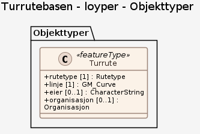

# Produktspesifikasjon: Turrutebasen

*Landsdekkende datasett som viser turruter. Datasettet inneholder fotruter, skiløyper, sykkelruter, andre turruter og tilretteleggingstiltak i friluftslivsområder. Dataene kan brukes i prosesser etter plan- og bygningsloven (kommuneplanlegging og saksbehandlingsom for eksempel byggesak) i kommunene, til analyser, rapportering, oppslag og visualisering av turruter til turplanlegging.*

**Nøkkelord:** Temadata, Friluftsruter, Ruter, Tur- og friluftsruter, Turruter, Tur, Løype, Løyper, Turkart, Sti, Skiløyper, Skiløype, TFR, geodataloven, Norge digitalt, beredskapsbase, Det offentlige kartgrunnlaget, modellbaserteVegprosjekter, fellesDatakatalog, Friluftsliv, skiløypeInfo, preparering, antallSkispor, skøytetrase, ryddebredde, Sykkelrute, sykkelruteInfo, rutenavn, rutenummer, vedlikeholdsansvarlig, spesialSykkelrutetype, gradering, rutetype, rutebetydning, ruteinformasjon, Fotrute, fotruteInfo, RuteGenerell, TurOgFriluftsrute, merking, skilting, ruteFølger, underlagstype, rutebredde, trafikkbelastning, belysning, spesialSkiløypetype, AnnenRuteInfo, spesialAnnenrutetype, RuteInfoPunkt, ruteinfoID, spesialFotrutetype

**Emnekategorier:** Samfunn og kultur

**Geografisk utstrekning**:

- **Vest**: 2.0
- **Øst**: 33.0
- **Sør**: 57.0
- **Nord**: 72.0

**Geografisk område**:
Fastlands-Norge med indre farvann og 50 km fra landegrensen

**Tidsmessig utstrekning**:

- **Tidsperiode**:
  - **Fra**: 2026-11-06
  - **Til**: 2026-11-06

## Om spesifikasjonen

> **Denne versjonen av produktspesifikasjonen:**  
> **Opprettet dato:**  
> **Endret dato:** 2026-11-06 
> **Språk:** nor 
> **Kontaktinformasjon:** Kartverket, [post@kartverket.no](mailto:post@kartverket.no)

## Termer og definisjoner
**Begrep** — kort forklaring

## Forkortelser

| Forkortelse | Betyr |
|-------------|-------|
| SOSI | Samordnet Opplegg for Stedfestet Informasjon |
| GML | Geography Markup Language |

## Om produktet Turrutebasen

> **Romlig representasjonstype:** Vektor 
> **Unik identifikator:** <https://data.geonorge.no/sosi/friluftsliv/tur_og_friluftsruter> 
> **Kontaktinformasjon:** Kartverket, [post@kartverket.no](mailto:post@kartverket.no)
>
> **Romlig oppløsning:**
>
> **Ekvivalent målestokk**: 1: 50000
>
> **Begrensninger:**
>
> **Ressursbegrensninger**:
>
> - **Bruksbegrensninger**: Åpne data. Datafangsten baserer seg stort sett på innmeldinger fra lag, foreninger og privatpersoner via karttjenesten "Rett i kartet". Data kontrolleres og vurderes manuelt i forhold til grunnlagsdata (FKB og N50-kartdata). Grunnlaget som er brukt for å definere en turrute kan være hentet fra ulike objekter som for eksempel FKB-TraktorvegSti, N50-kartdata, digitalisert fra ulike turkart, ortofoto eller andre grunnlagskart. Data kan også være innsamlet ved hjelp av håndholdt GPS. Kvaliteten på turrutene avhenger av de målemetodene eller registreringsmetodene som er brukt for den enkelte turrute.
>
> **Juridiske begrensninger**:
>
> - **Tilgangsbegrensninger**: Åpne data
> - **Bruksbegrensninger**: Lisens
> - **Lisens**: Creative Commons BY 4.0 (CC BY 4.0)
> - **Lisenslenke**: <https://creativecommons.org/licenses/by/4.0/>

### Formål

Datasett til bruk i offentlig forvaltning og for tur- og friluftsformål.

### Bruksområde

Dataene skal være et verktøy for kommunen i saksbehandling, planlegging og rapportering, sikre god forvaltning av friluftsområder ved å være viktig basisinformasjon i arbeidet med kartlegging og verdsetting av friluftslivsområder og være viktig basisinformasjon i arbeidet med kommunale sti- og løypeplaner, sikre godt kartgrunnlag i redningsaksjoner og utrykninger og være grunnlag for avledede produkter for friluftslivet. 

Når data samles i en nasjonal database, vil alle brukere av datasettet få det samme utgangspunktet som kan danne grunnlaget i andre produkter. 

Datasettet egner seg som grunnlag på alle nivåer i plan- og byggesaksarbeid; i nasjonale planer, fylkes-, region og kommuneplan, byggesaker, ROS-analyser og konsekvensutredninger. Spesielt er geometrien viktig for å vise hvor turruter og løyper går. I tillegg kan egenskaper som for eksempel spesialrutetype, rutetype og rutebetydning si mer om hva slags rute og/eller løype som er registrert.

## Omfang

### Hele datasettet

**Nivå**: dataset

**Nivåbeskrivelse**: Gjelder hele datasettet. Hvis omfang ikke er oppgitt under en overskrift, gjelder teksten for hele datasettet og alle leveranser

### loyper

**Nivå**: dataset

**Nivåbeskrivelse**: Datamodell (Egen modell)

## Datainnhold og struktur

### Datamodell - loyper

➡️ [Se full datamodell for omfang "loyper" (diagram per pakke og objektkatalog)](loyper/objektkatalog.html)

## Referansesystem

| EPSG-kode | Navn på referansesystem |
| --- | --- |
| [EPSG:25832](https://epsg.io/25832) | [EUREF89 UTM sone 32, 2d](https://register.geonorge.no/epsg-koder) |
| [EPSG:25833](https://epsg.io/25833) | [EUREF89 UTM sone 33, 2d](https://register.geonorge.no/epsg-koder) |
| [EPSG:25835](https://epsg.io/25835) | [EUREF89 UTM sone 35, 2d](https://register.geonorge.no/epsg-koder) |
| [EPSG:3035](https://epsg.io/3035) | [EUREF89 / ETRS89-LAEA Europe](https://register.geonorge.no/epsg-koder) |
| [EPSG:4258](https://epsg.io/4258) | [EUREF 89 Geografisk (ETRS 89) 2d](https://register.geonorge.no/epsg-koder) |
| [EPSG:4326](https://epsg.io/4326) | [WGS84 Geografisk](https://register.geonorge.no/epsg-koder) |

## Datakvalitet

**Nivå**: dataset

**Kvalitetsmål**: SOSI produktspesifikasjon: Turrutebasen

- **Beskrivende resultat**: Dataene er i henhold til produktspesifikasjonen

**Kvalitetsmål**: Sosi applikasjonsskjema

- **Beskrivende resultat**: SOSI-filer er i henhold til applikasjonsskjema

**Kvalitetsmål**: Sosi applikasjonsskjema

- **Beskrivende resultat**: GML-filer er i henhold til applikasjonsskjema

**Kvalitetsmål**: Prosentvis oppfyllelse av FAIR-prinsipper

- **Målebeskrivelse**: Angir fullstendighet i forhold til krav fra FAIR-prinsippene (The FAIR Guiding Principles for scientific data management and stewardship)
- **Resultat**: 100

## Datafangst og produksjon

Departementet tildelte Kartverket oppgaven å samarbeide med Miljødirektoratet om en felles satsning for etablering av nasjonale sti- og løypedata i 2009. Det ble fra da av arbeidet med en fagområdestandard for Friluftsliv. En første versjon av produktspesifikasjon for Turrutebasen var ferdig i desember 2013, og database og rutiner for lagring av data i databasen var i drift fra samme tid (desember 2013). Siden da har det pågått kontinuerlig lagring av data i databasen. Fullstendighet: Data innhentes via publikumsløsningen Rett i kartet samt etter avtale med dataeiere som for eksempel kommuner, fylkeskommuner, lag/foreninger, frivillige organisasjoner og andre. Datasettets fullstendighet varierer fra område til område, da datainnsamlingen i stor grad baserer seg på frivillig innraportering. Stedfestingsnøyaktighet: Krav til nøyaktighet ved innsamling av data er viktig for å oppnå en mest mulig ensartet data¬inn¬samling. Det er et ønske at det alltid tilstrebes data med best mulig nøyaktighet. Mottatte data sammenlignes alltid med primærdata, som for eksempel FKB-TraktorvegSti, og det finnes rutiner for å bytte ut geometri med tilgjengelig geometri som er av bedre kvalitet. Kvaliteten på rutene avhenger av de målemetodene eller registreringsmetodene som er brukt for den enkelte rute, og kan ha varierende nøyaktighet, detaljering og fullstendighet etter hvilke kilder dataene kommer fra. Det er derfor viktig for brukeren å lese kvalitetsopplysningene på dataene, og vurdere dette opp mot bruken av dataene. Grunnlaget for å definere en turrute kan være ulike objekter fra for eksempel FKB-TraktorvegSti, N50-kartdata, eller digitaliserte ruter fra ulike turkart, ortofoto eller andre grunnlagskart. Det kan også være data innsamlet ved hjelp av håndholdt GPS. Dersom geometri hentes fra andre baser, skal kvaliteten følge geometrien. For eksempel, hvis en henter grunnlagsdata fra N50 eller FKB, vil kvalitetskodingen fra disse dataene beholdes. Data høstet med GPS, digitalisert eller manuelt inntegnet på kart, kodes som anbefalt i kapittel 5.1.2.11 Målemetode. På grunn av ulike feilkilder vil en i Turrutebasen ikke angi bedre nøyaktighet enn 1 m selv om GPS i prinsippet kan gi det. Det anbefales å bruke 10-15 m som beste kvalitet. Målemetode og nøyaktighet i grunnriss er påkrevde egenskaper, mens synbarhet er en valgfri egenskap. Egenskapsnøyaktighet: Data innhentes via publikumsløsningen Rett i kartet samt etter avtale med dataeiere som for eksempel kommuner, fylkeskommuner, lag/foreninger, frivillige organisasjoner og andre. Egenskapsnøyaktigheten er avhengig av kilden til dataene og vil variere. Tidfestingsnøyaktighet: Datafangstdato beskriver når dataene er innhentet. Datafangstdato kan være tidspunkt for flyfoto ved konstruksjon, når turruta er kartlagt i terreng eller når ruta er meldt inn til Kartverket. Logisk konsistens: Dataene følger reglene i produktspesifikasjonen

## Vedlikehold

**Vedlikeholdsfrekvens**: Ukentlig

**Status**: Kontinuerlig oppdatert

## Leveranse

| Tjeneste | Endepunkt | Type | Format | Leveranseenheter |
| --- | --- | --- | --- | --- |
| Geonorge nedlastning | [Lenke](https://nedlasting.geonorge.no/api/capabilities/d1422d17-6d95-4ef1-96ab-8af31744dd63) | GEONORGE:DOWNLOAD | FGDB, GML, GPX, PostGIS, SOSI | fylkesvis, kommunevis, landsfiler |
| Atom Feed | [Lenke](http://nedlasting.geonorge.no/geonorge/ATOM-feeds/TurOgFriluftsruter_AtomFeedFGDB.xml) | W3C:AtomFeed | FGDB | fylkesvis, kommunevis, landsfiler |
| Atom Feed | [Lenke](http://nedlasting.geonorge.no/geonorge/ATOM-feeds/TurOgFriluftsruter_AtomFeedGML.xml) | W3C:AtomFeed | GML | fylkesvis, kommunevis, landsfiler |
| Atom Feed | [Lenke](http://nedlasting.geonorge.no/geonorge/ATOM-feeds/TurOgFriluftsruter_AtomFeedGPX.xml) | W3C:AtomFeed | GPX | fylkesvis, kommunevis, landsfiler |
| Atom Feed | [Lenke](http://nedlasting.geonorge.no/geonorge/ATOM-feeds/TurOgFriluftsruter_AtomFeedPostGIS.xml) | W3C:AtomFeed | PostGIS | fylkesvis, kommunevis, landsfiler |
| Atom Feed | [Lenke](http://nedlasting.geonorge.no/geonorge/ATOM-feeds/TurOgFriluftsruter_AtomFeedSOSI.xml) | W3C:AtomFeed | SOSI | fylkesvis, kommunevis, landsfiler |
| Turrutebasen WMS | [Lenke](https://wms.geonorge.no/skwms1/wms.friluftsruter2?request=GetCapabilities&service=WMS&version=1.3.0) | WMS-tjeneste | OGC WMS |  |
| GeoPackage: loyper | [Lenke](https://raw.githubusercontent.com/larsingea/ps_demo2/main/produktspesifikasjon/turrutebasen/loyper/loyper.gpkg) | Nedlasting | GPKG |  |

## Metadata

**Metadatastandard**: ISO19115

**Metadatastandardversjon**: 2003

**Metadatadato**: 2026-11-08

**språk**: nor

**Kontakt**:

- **Organisasjon**: Kartverket
- **Kontaktperson**: Grunndataavdelingen
- **Logo**: <https://register.geonorge.no/data/organizations/971040238_Kartverket_liten.png>
- **Epost**: post@kartverket.no
- **rolle**: pointOfContact

**Metadataidentifikator**:

- **Utsteder**: Geonorge
- **kode**: d1422d17-6d95-4ef1-96ab-8af31744dd63
- **koderom**: <https://kartkatalog.geonorge.no/metadata/>
- **Metadatalenke**: <https://kartkatalog.geonorge.no/metadata/d1422d17-6d95-4ef1-96ab-8af31744dd63>

## Tilleggsinformasjon

Sti, turrute og turforslag er begreper som brukes mye i forbindelse med datasettet og som henger tett sammen. Mens stien er det konkrete objektet, som er gjenfinnbart i terrenget og som kan være merket eller umerket, er turruta noe mer enn bare en sti. Turruta er tilrettelagt med merking og/eller skilting og hvor noen har et vedlikeholdsansvar for at den er fremkommelig. 
Turrute er en samlebetegnelse for tursti, løype, samt turveg og led for vandring, skigåing, sykling eller padling/roing. En turrute kan følge ulike fysiske objekter som for eksempel sti, traktorveg eller veg, eller også mindre konkrete objekter som myr og høydedrag.
Stien forvaltes i en nasjonal database kalt FKB-traktorvegSti. Turruter ønskes samlet i en nasjonal database kalt Turrutebasen. Turforslag, som er en beskrivelse av en tur, forvaltes ikke av Kartverket.

- **Produktside:** [http://www.kartverket.no/Kart/Geodatasamarbeid/Temadata/Nasjonal-database-for-tur--og-friluftsruter/](http://www.kartverket.no/Kart/Geodatasamarbeid/Temadata/Nasjonal-database-for-tur--og-friluftsruter/)
